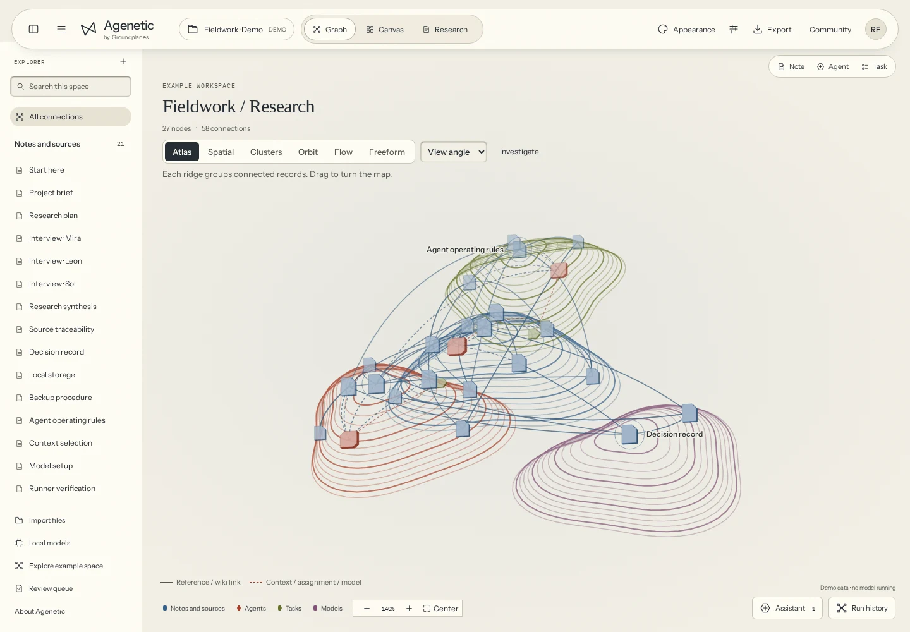
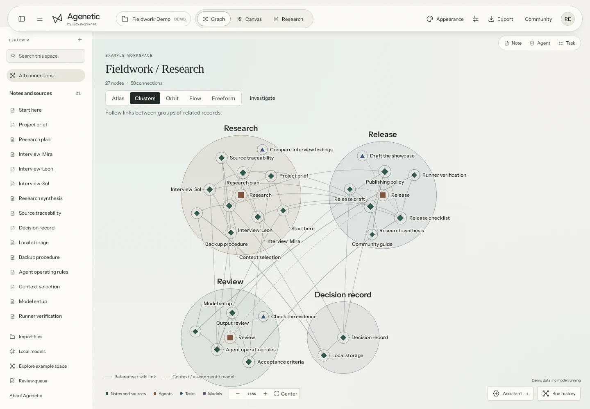
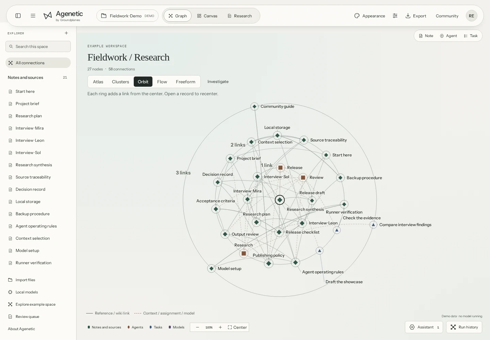
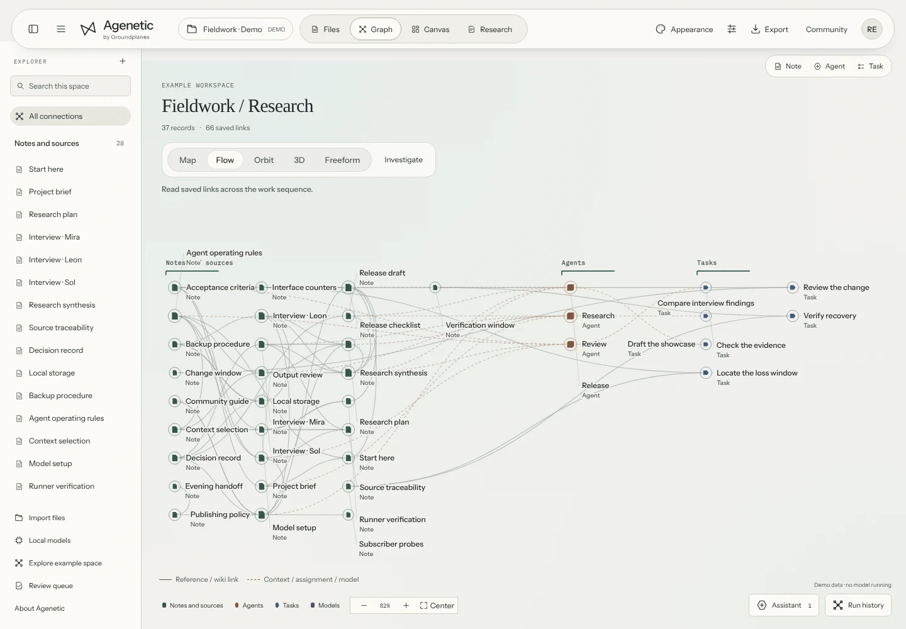
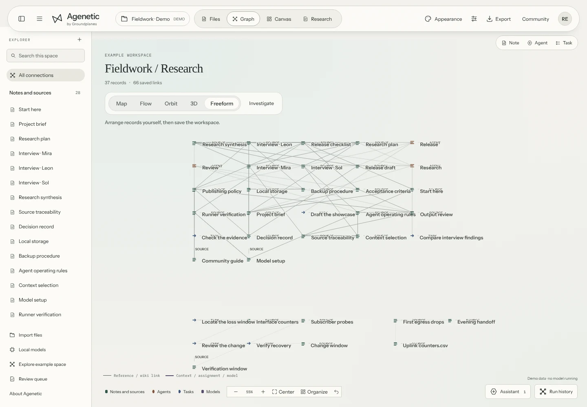
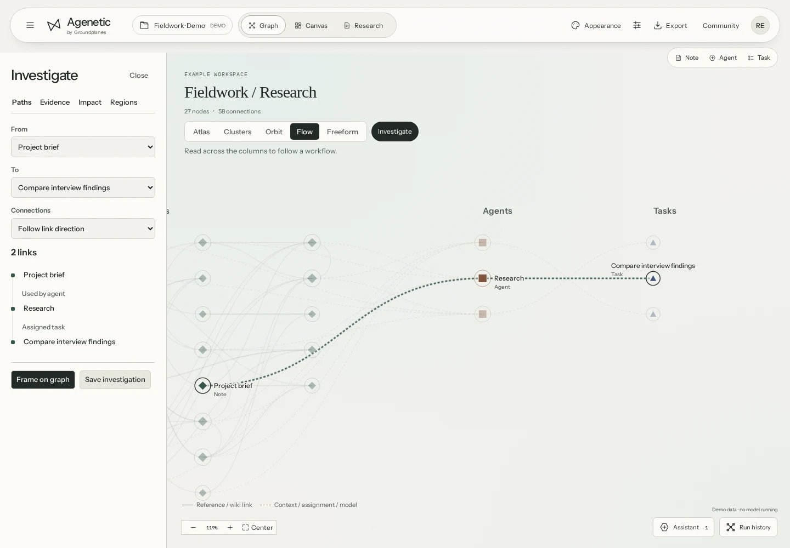
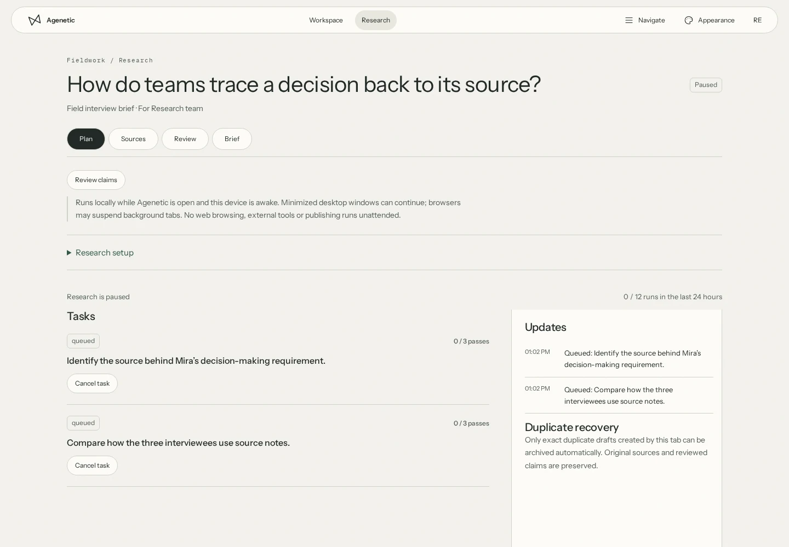
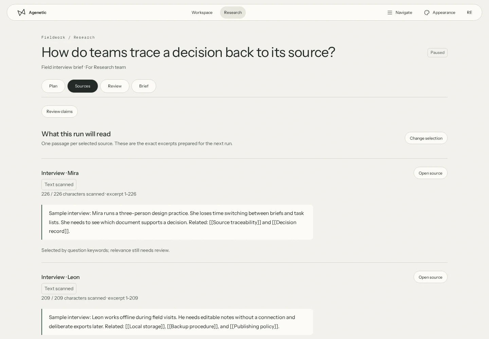
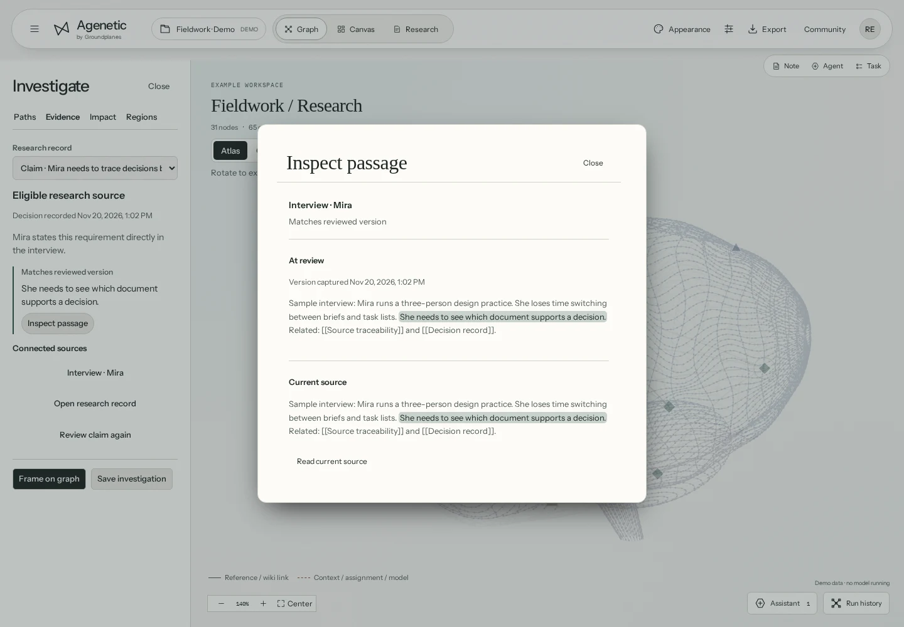

# Agenetic by Groundplanes

A local research workspace for connecting source documents, notes, and model runs. Open a workspace in Graph or Canvas, attach sources to an agent, then review the resulting excerpts, drafts, and claims alongside their sources.

**Windows x64 beta** · [Download from Releases](https://github.com/T6ck/Agenetic-By-groundplanes/releases) · [Changelog](CHANGELOG.md) · [Report a bug](https://github.com/T6ck/Agenetic-By-groundplanes/issues/new/choose)

## Install

1. Open a beta release and download its `Agenetic-Setup-…-x64.exe` from **Assets**.
2. Run Setup and follow the in-app onboarding. Start with the example workspace or create your own.
3. Open **Models** to register a local GGUF or find one on Hugging Face. The Windows installer includes a CPU runner. Model weights are a separate download.

If you installed an unsigned preview, run the signed Windows installer once to join the beta update channel.

Agenetic checks GitHub at startup and hourly, downloads updates in the background, and installs them when you close the app. Open **Navigate → Releases → Check for updates** to see your version and update status.

## Working in Agenetic

- Import notes and PDFs, link sources in Graph, and arrange steps in Canvas.
- Run evidence-only searches over connected sources or draft with a local model. Review drafts and claims against the original material.
- Export workflows or back up the local vault. Community posting is optional. Release checks, model downloads, community activity, and remote MCP tools use the network when applicable.

Agenetic is free for personal use. Commercial use requires a license from Groundplanes.

## Graph layouts

Open **Graph** and choose the layout that fits your question. Atlas groups connected records on a rotatable surface. Clusters separates those groups so you can see the links between them. Orbit counts links from a record you choose. Flow separates sources, agents and tasks into columns. Freeform keeps your hand-placed positions. Each workspace remembers its choice.

**Investigate** traces paths and checks the passages behind a claim. Open a source and select **Check source impact** to find the claims that depend on it. Save an investigation to run the same question again after editing a source.

| Atlas | Clusters | Orbit |
| --- | --- | --- |
|  |  |  |
| **Flow** | **Freeform** | **Trace a path** |
|  |  |  |
| **Research plan** | **Source passages** | **Review a quotation** |
|  |  |  |

The screenshots use the Fieldwork demo in Porcelain. [View Atlas in Graphite](docs/screenshots/gallery/atlas-graphite.webp).

## Project links

- [Beta testing and release process](CONTRIBUTING.md)
- [Private security reporting](SECURITY.md)
- [Groundplanes](https://groundplanes.com) · [hello@groundplanes.com](mailto:hello@groundplanes.com) · [@GroundplanesCo](https://x.com/GroundplanesCo)

## Research workflow and beta limits

The research project flow connects Plan, Sources, Review and Brief. Inspect selected passages, review claims and approve brief updates. New reviewed evidence retains source revisions so changed material can be checked again.

[Implementation and remaining gates](docs/research-project-implementation.md) · [Graph investigation research](docs/graph-investigations-research.md)

Screenshots show example/test data, not validated findings. Features on main can precede a downloadable release; check its release notes.
