# Agenetic screenshots

These are captures of the Fieldwork example in the Porcelain theme. Select an image to view it at full size.

## Turning and pulling the graph

| Atlas | After a vertical drag | After a roll |
| --- | --- | --- |
| [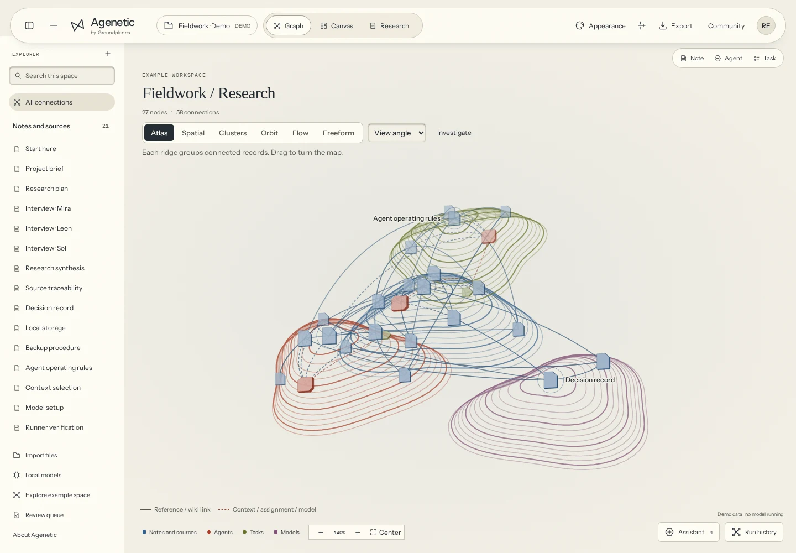](gallery/atlas.webp) | [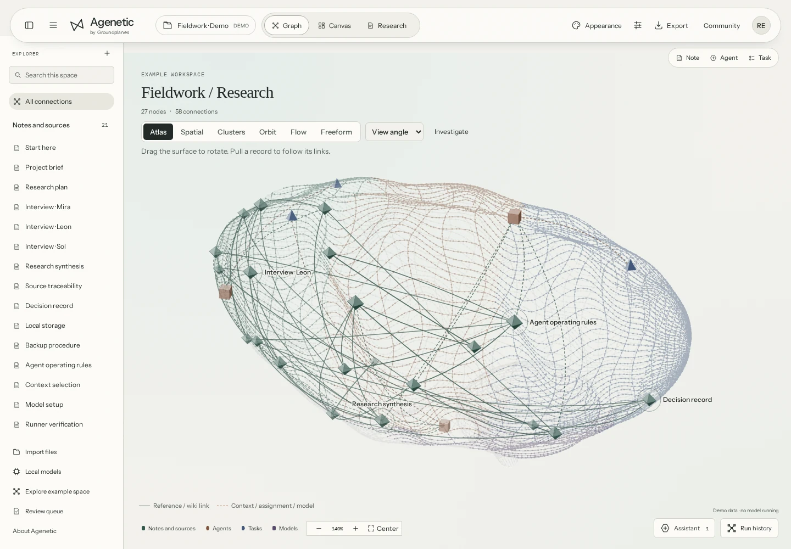](gallery/atlas-tilt.webp) | [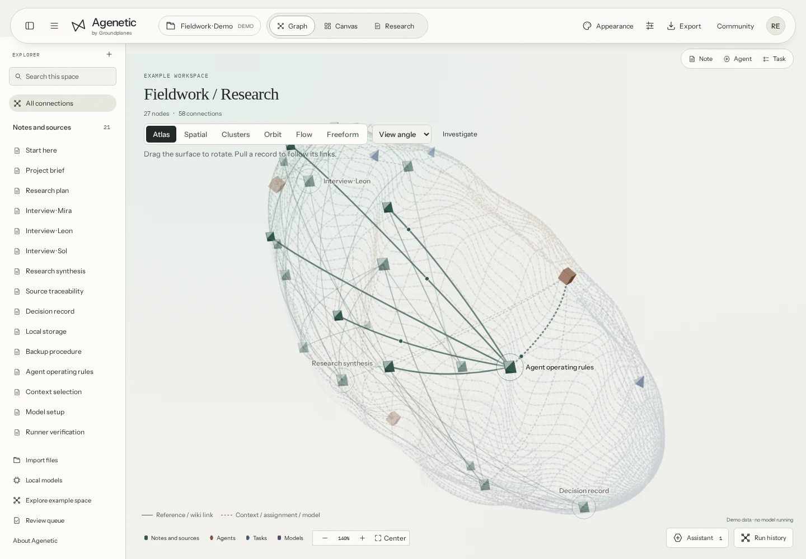](gallery/atlas-roll.webp) |
| **Spatial** | **After turning** | **Pulling a record** |
| [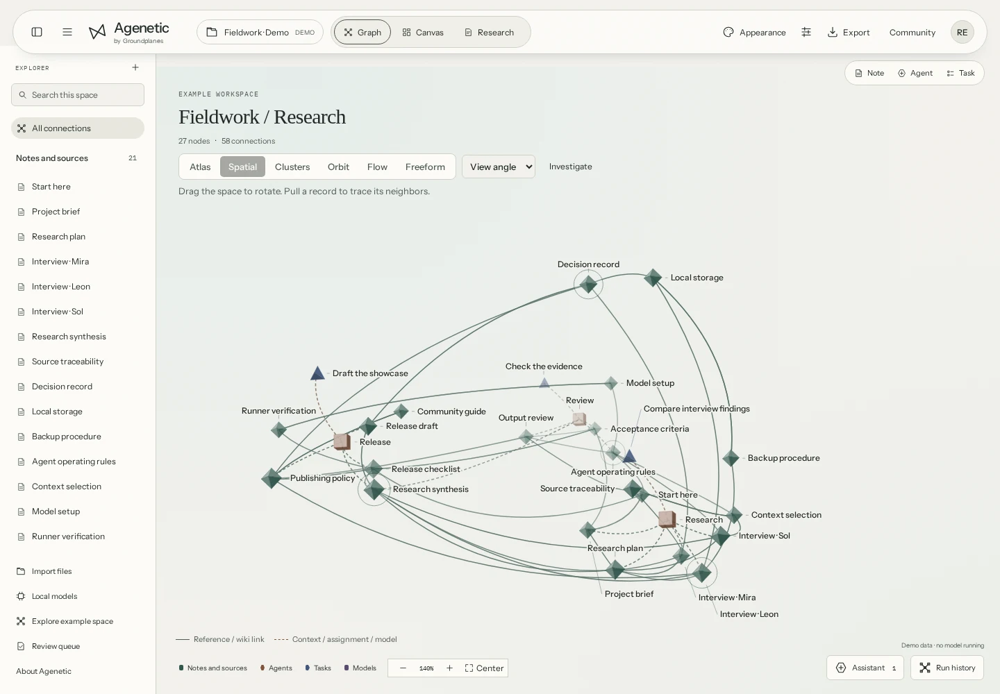](gallery/spatial-home.webp) | [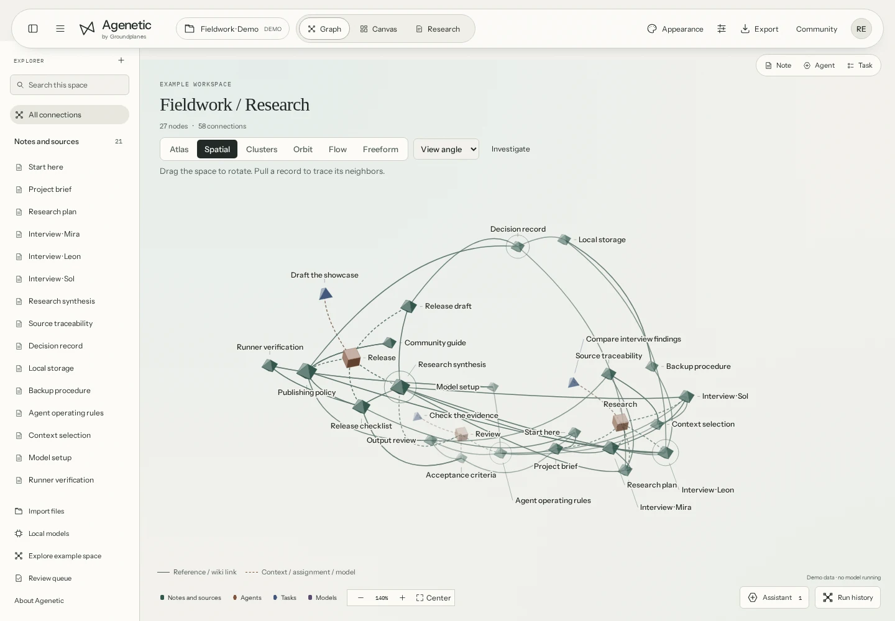](gallery/spatial-turned.webp) | [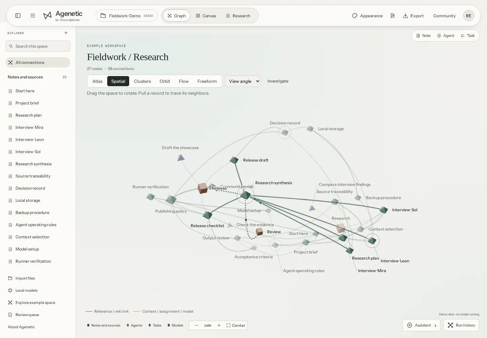](gallery/spatial-pull.webp) |

[Atlas in the Graphite theme](gallery/atlas-graphite.webp)

## Other layouts

| Clusters | Orbit |
| --- | --- |
|  |  |
| **Flow** | **Freeform** |
| [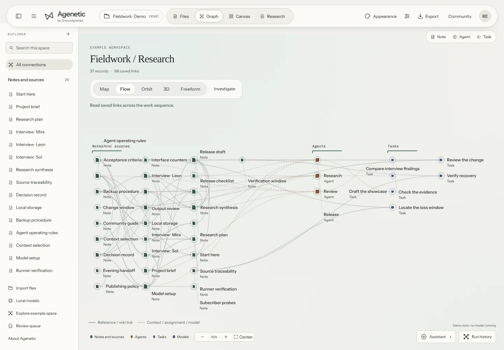](gallery/flow.webp) | [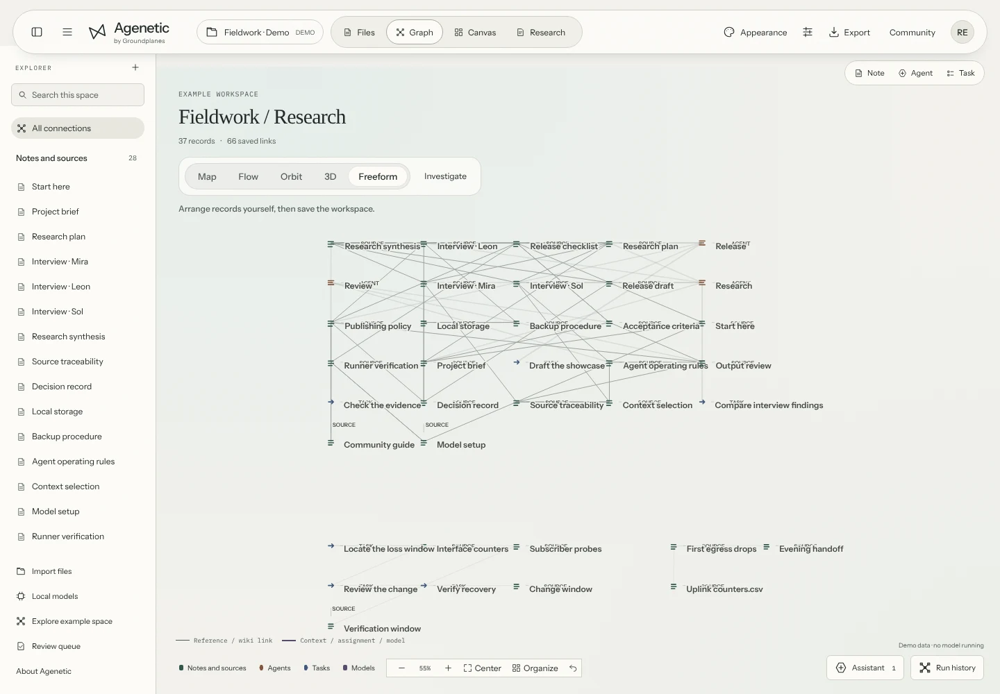](gallery/freeform.webp) |

## From a question to a source

| Trace a path | Plan a project |
| --- | --- |
| [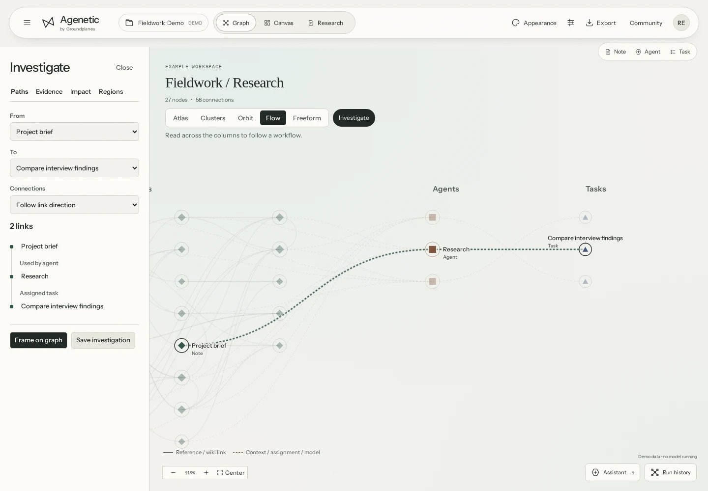](gallery/paths.webp) | [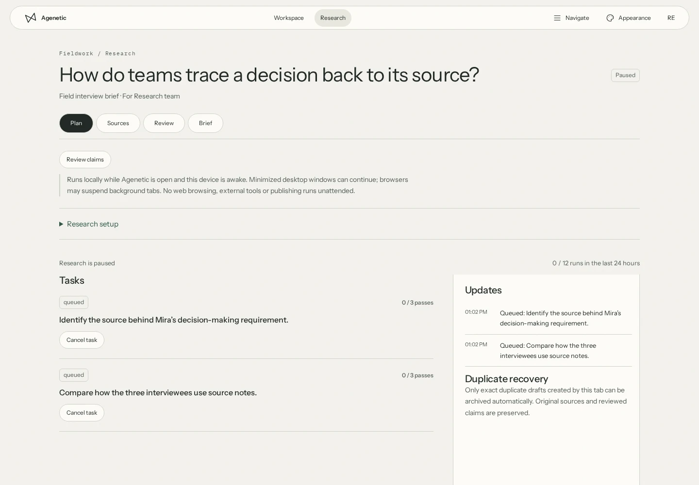](gallery/research.webp) |
| **Inspect source passages** | **Review a quotation** |
| [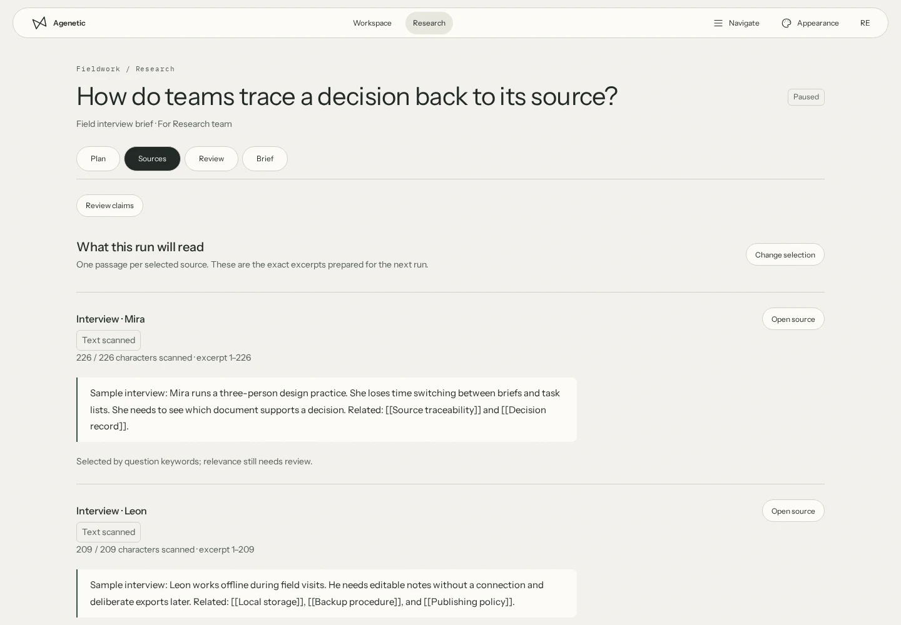](gallery/sources.webp) | [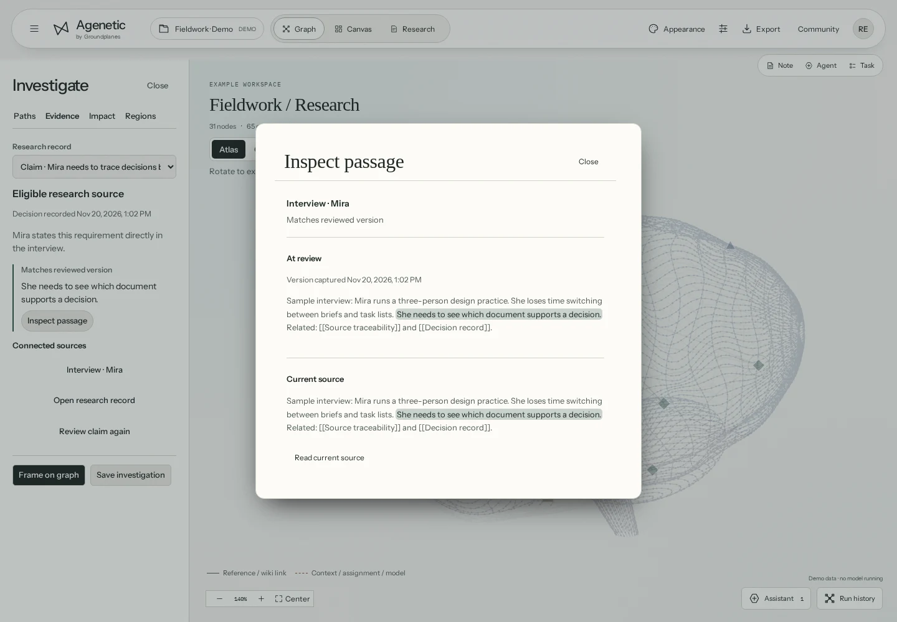](gallery/review.webp) |
