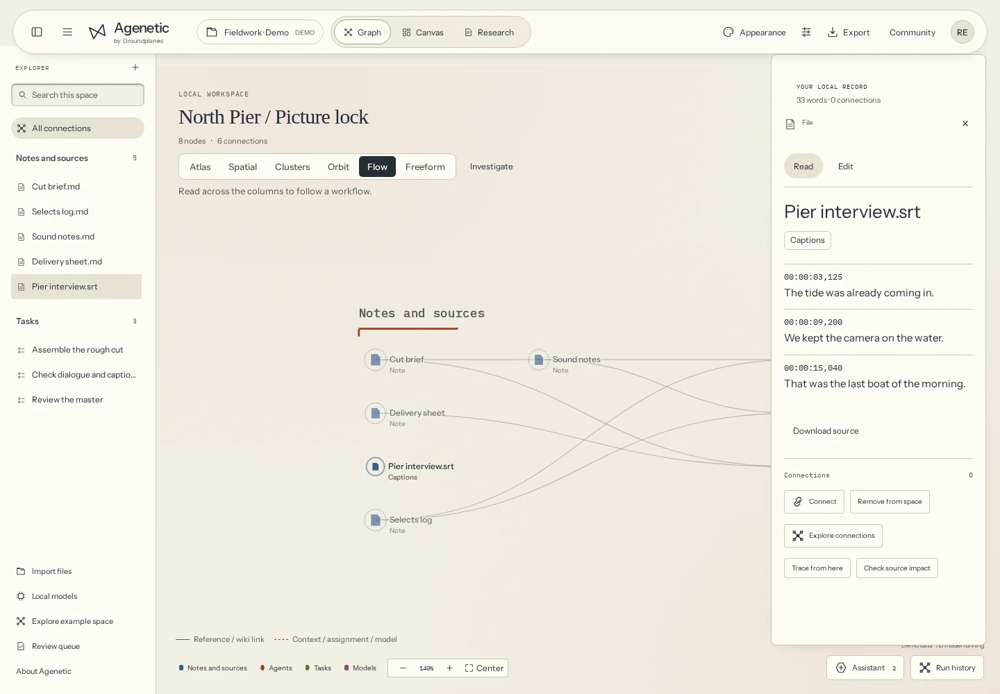
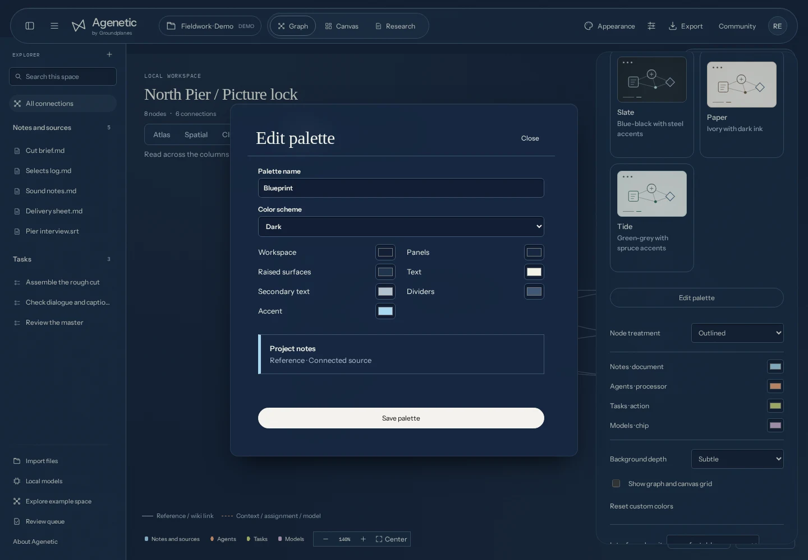
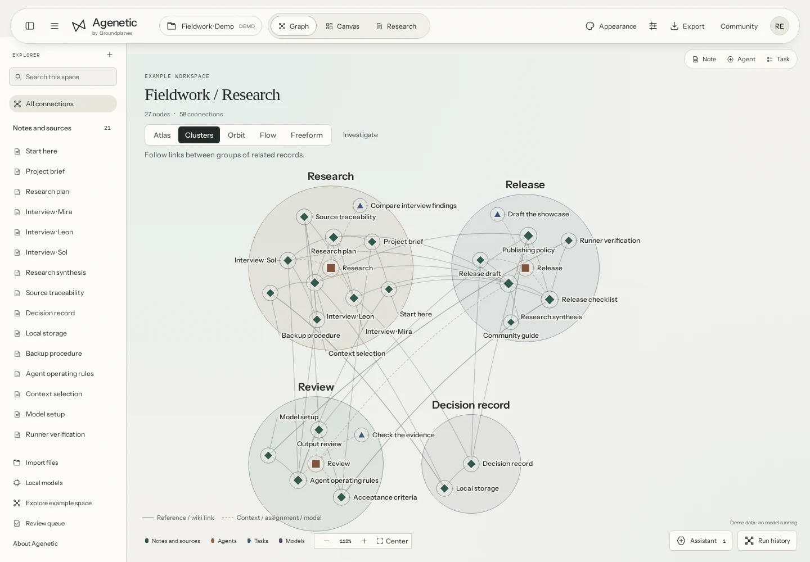
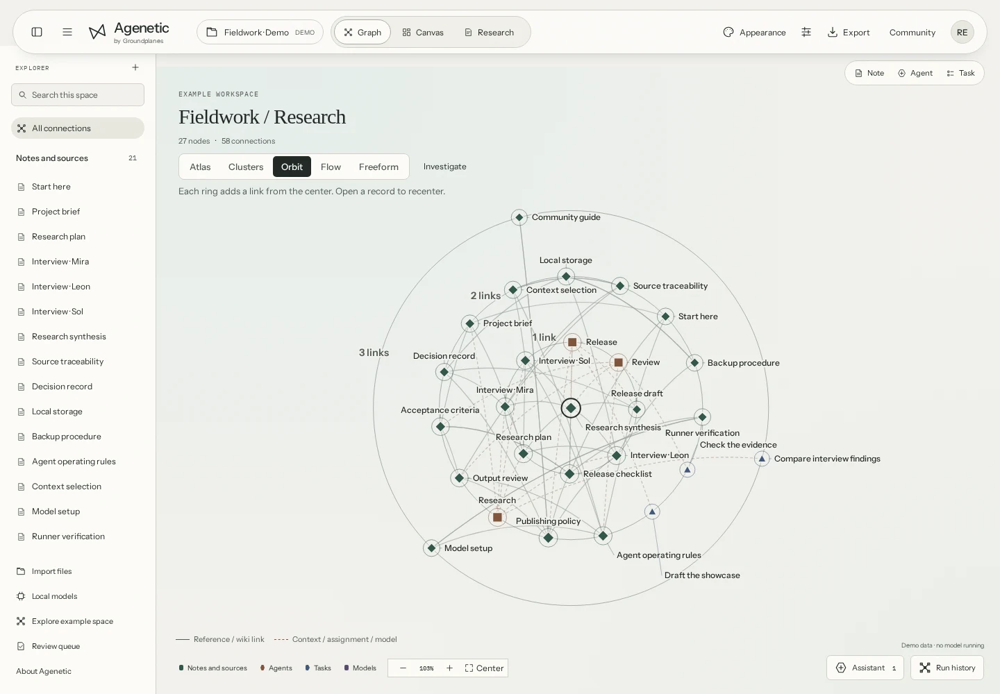

# Agenetic screenshots

Select a screenshot to open the full-size capture.

| Atlas in Plotter | Video edit with captions | Blueprint palette editor |
| --- | --- | --- |
|  |  |  |

## Other layouts

| Clusters | Orbit |
| --- | --- |
|  |  |
| **Flow** | **Freeform** |
|  |  |

## From a question to a source

| Trace a path | Plan a project |
| --- | --- |
|  |  |
| **Inspect source passages** | **Review a quotation** |
|  |  |
